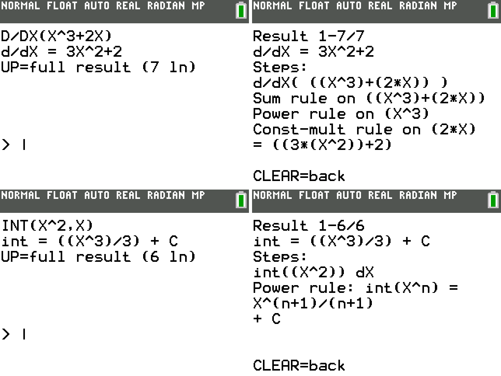

# Algebrix CE

A computer algebra system for the TI-84 Plus CE graphing calculator, written in C99.

[](https://github.com/XanderXML-Bit/algebrix-ce/actions/workflows/test.yml)




Screenshot from the CEmu emulator using an owned TI-84 Plus CE OS 5.8 ROM.

Watch the recorded CEmu demo on the [Algebrix CE project page at zendren.net](https://zendren.net/projects/algebrix-ce).

Algebrix CE was first developed as CalcEngine. The on-calculator program is still named `CALCENG`, and many source files, scripts and documents still use the old name.

## Try the desktop solver

Use GCC or Clang and GNU Make. On Debian or Ubuntu, install them with `sudo apt install build-essential`.

From the repository root, build the solver and try a derivative.

```bash
make -C tests
./bin/calcengine --solve 'd/dx(x^3)' --show-steps
```

## What it is

You type an expression such as `d/dx(x^2*sin(x))` or `int(1/(x*(x+1)),x)`. Algebrix CE works out which kind of problem it is, solves it symbolically, and can show the steps.

The TI-84 Plus CE is a tight target:

- an eZ80 processor with no floating-point hardware;
- about 256 KB of RAM and a 51,200-byte limit per program module;
- a 320×240 screen and the calculator keypad as the only input.

The engine therefore uses no dynamic allocation at all. Expressions live in a fixed pool of 512 syntax-tree nodes. The program is split into a launcher and 34 worker modules that the launcher swaps in from archive memory as needed.

## What it covers

| Area | Examples |
|---|---|
| Derivatives | power, product, quotient and chain rules; trigonometric, hyperbolic, exponential and logarithmic functions; implicit and higher-order derivatives; tangent lines |
| Integrals | u-substitution, integration by parts, trigonometric substitution, partial fractions, definite and improper integrals, Simpson and trapezoidal rules |
| Limits | substitution, factoring, rationalisation, L'Hôpital's rule, one-sided limits and limits at infinity |
| Series | convergence tests, Taylor and Maclaurin series, radius and interval of convergence |
| Differential equations | separable and first-order linear equations, second-order linear equations with constant coefficients, Euler's method |
| Algebra | equation and polynomial solving, polynomial division, factoring |
| Matrices | arithmetic, determinant, inverse, row reduction, eigenvalues up to 3×3 |
| Statistics and probability | descriptive statistics, regressions, hypothesis tests, common distributions |
| Other | complex numbers, lists, finance (time value of money), graphing, stored variables |

Coverage is not the same as correctness on every input. The next section says what is and is not verified.

## Current status

- **Desktop build:** the full C test harness builds and passes on Linux with GCC. See "Run the tests".
- **Emulator:** the program is tested on the CEmu emulator with a real OS 5.8 ROM through `tools/emulator/linux-realrom`. That battery still has **known failures**. They are recorded in `tests/cemu/edge-cases/module-battery.json`, and a release is blocked until they are fixed.
- **Real calculator:** no current build is certified on physical hardware.

Some older documents in `docs/` describe an earlier emulator lane that drove the TI-OS home screen rather than Algebrix CE. Those results are historical and are not evidence for the current build. Where a document carries that warning, trust the warning.

## Repository layout

| Path | Contents |
|---|---|
| `src/` | the engine: tokenizer, Pratt parser, syntax tree, evaluator, simplifier and each solver |
| `src/core/launcher/` | the on-calculator launcher, home screen and result viewer |
| `src/modules/`, `src/split/` | worker modules and the protocol the launcher uses to call them |
| `split/` | one makefile per worker module for the calculator build |
| `tests/` | the desktop C harness (`test_main.c`), focused unit harnesses, mocks of the TI libraries, Vitest suites and the Python CEmu tests |
| `tools/emulator/` | emulator automation, including the headless CEmu wrapper and the real-ROM runner |
| `tools/desktop/` | a desktop command-line solver |
| `scripts/` | test runners, emulator helpers, and [standalone Windows desktop builds](scripts/windows/) |
| `docs/` | usage guides, architecture, and validation records |
| `examples/` | small examples of the memory pool and simplifier patterns |

## Run the tests

```bash
make -C tests run
```

`make run` builds and runs the main harness and the focused harnesses for formatting, floating-point classification, tiny values and the split modules. Each prints a pass and fail count, and the command exits non-zero on any failure.

On Linux, use the sanitizer build to check for memory errors and undefined behavior.

```bash
make -C tests run-asan
```

Run the Vitest suites with Node.js 22 on x86-64 Linux. The lockfile includes a required Linux x86-64 Rollup binary.

```bash
npm ci
npm test
```

The Python CEmu tests use Python 3.13 in CI. Install `pytest`, `pytest-timeout`, and `pyyaml` in a virtual environment, then run `python -m pytest tests/cemu -q`. Tests that exercise the calculator build also need CEmu, an owned ROM, and built modules.

## Build for the calculator

Install [CE C/C++ Toolchain v11.2](https://github.com/CE-Programming/toolchain/releases/tag/v11.2) (CEdev), the version used by the release workflow. See the [toolchain setup guide](docs/TOOLCHAIN.md).

```bash
make
```

The default target builds the `CALCENG` launcher and every worker module from the makefiles in `split/`, then checks each module's stack use. Each module must stay at or below 51,200 bytes.

To run the program you also need the CE C libraries (LibLoad, GRAPHX, FILEIOC and KEYPADC). They are published with the CE toolchain and are not included here. Calculators on OS 5.5 or later block unsigned assembly programs. Running Algebrix CE on them needs a third-party jailbreak, which is also not included.

## Test on the emulator

The CEmu lanes need a TI-84 Plus CE ROM image. Follow the [ROM acquisition guide](docs/ROM-ACQUISITION.md) to dump the ROM from a calculator you own.

See the [real-ROM runner guide](tools/emulator/linux-realrom/README.md) for build and test commands. The older PowerShell scripts in `tools/emulator/` target Windows and accept paths as parameters.

## Design notes

- **Static memory only.** There is no `malloc` or `free` anywhere. Nodes come from a 512-node pool with a free stack, so allocation and release are O(1). A bitmap guards against double frees.
- **Bounded stack.** The eZ80 stack is small, so recursion depth is limited and measured per worker module. `docs/CE-WORKER-STACK-BOUNDS.md` has the measurements.
- **Soft floating point.** The calculator's `float` is 32-bit and implemented in software. `src/ce_float_ops.h` and `src/ce_float_class.h` work around rounding and overflow behaviour measured on the real OS 5.8 ROM.
- **Module routing.** The launcher classifies each input and sends it to the worker that can answer it. `docs/MULTI-PROGRAM-ARCH.md` describes the protocol.

## Documentation

Find installation, keypad, architecture, and test guides in the [documentation index](docs/README.md). See the [changelog](CHANGELOG.md) for release history.

## Third-party code

Three third-party pieces keep their own licences. They are listed in [`THIRD-PARTY-NOTICES.md`](THIRD-PARTY-NOTICES.md), and the licence texts are in `LICENSES/`.

- `tools/emulator/cemu-headless/vendor/stb_image_write.h`, by Sean Barrett: MIT or public domain.
- The GRAPHX font table in `tools/emulator/cemu-headless/main.c`, from the CE-Programming toolchain: LGPL-3.0.
- `tools/emulator/linux-realrom/cemu-headless-debug.patch`, a patch against CEmu: GPL-3.0.

TI-84 Plus CE and TI-OS are trademarks of Texas Instruments. This project is not affiliated with or endorsed by Texas Instruments.

## License

Copyright © 2026 Xander M. Lopez (Zendren). All rights reserved. The source is published to read. It is not licensed for reuse or redistribution. See [`LICENSE`](LICENSE). The third-party pieces above are excepted and keep their own licences.

Built by [Xander M. Lopez](https://xandermlopez.com) · [Zendren](https://zendren.net)
